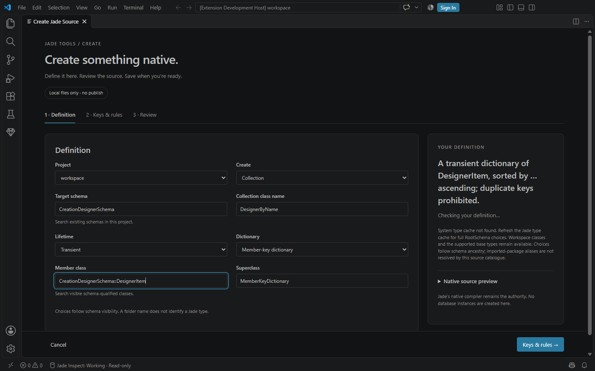
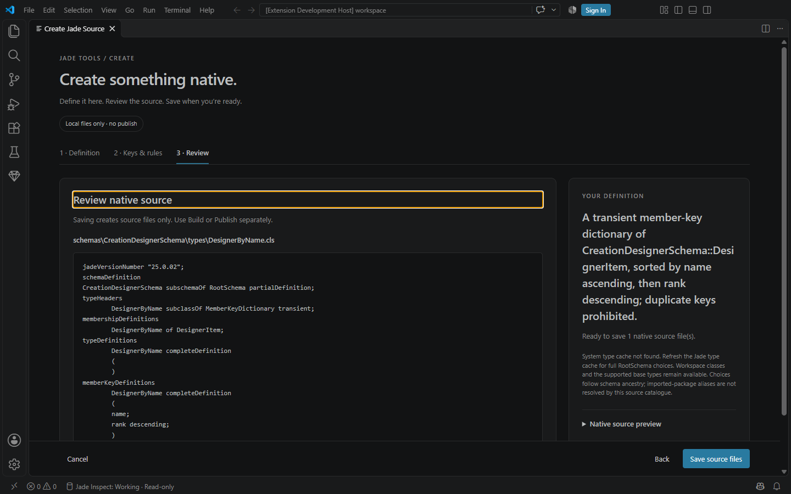
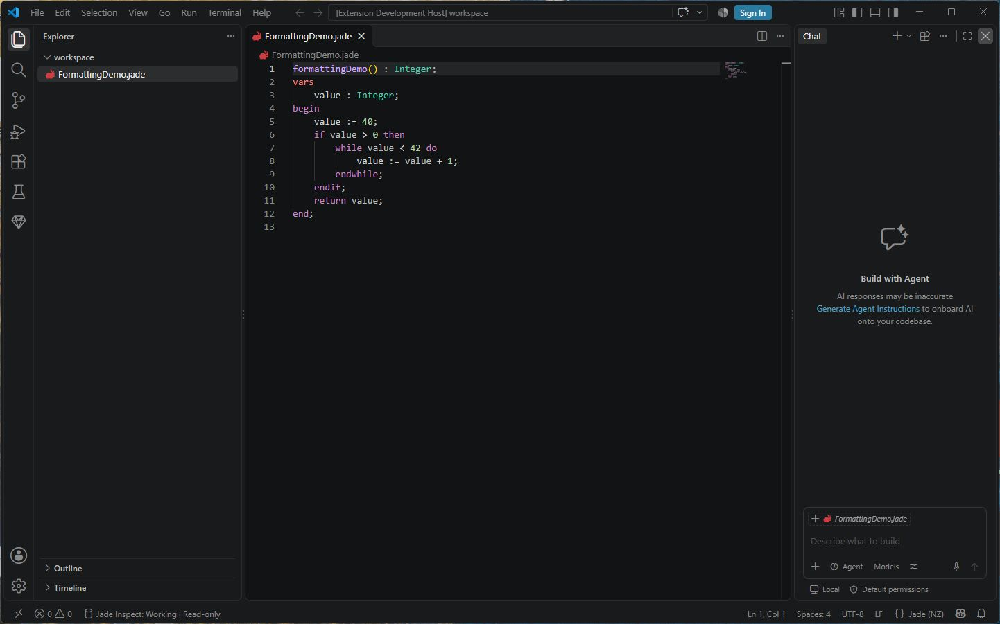
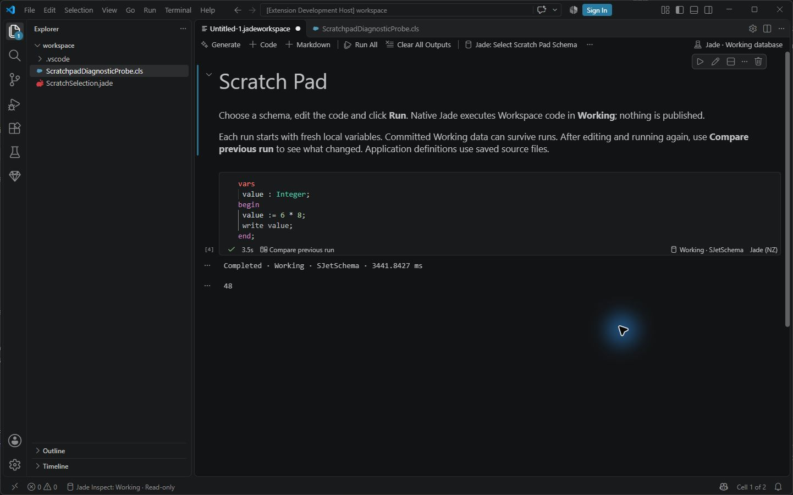
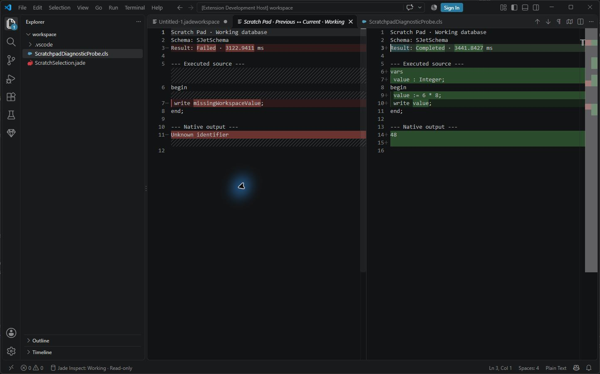
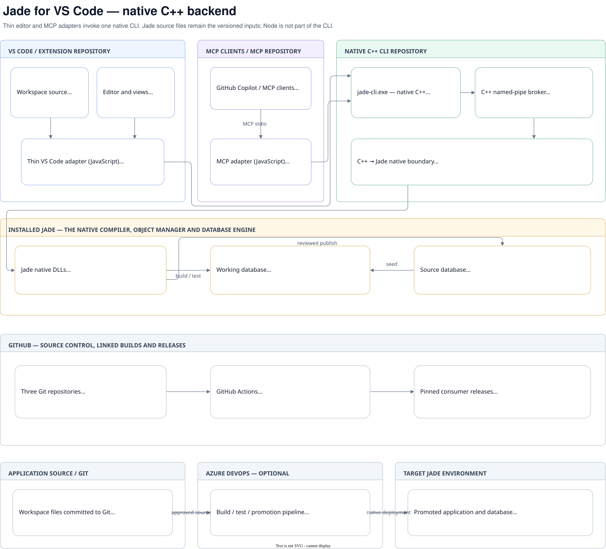

# Jade VS Code extension

## Development test artifacts

Host checks create one disposable private profile, extension copy, workspace and native broker context. The harness keeps a compact report in `evidence/` and removes its run directory after success, failure or cancellation once its own host and native processes have exited. It never scans or deletes other runs, user databases or source folders. If ownership changes or a process remains alive, cleanup fails explicitly and reports the retained path.

Each run checks for at least 2 GiB free before copying. This is an admission check, not a reservation against other applications or simultaneous runs; run database-heavy host checks sequentially and provide additional space for larger Source databases. No reusable database cache is required by this harness. If one is introduced, it belongs under `%LOCALAPPDATA%/JadeTools/test-cache` with bounded retention, not Temp or the source workspace.

Independent development workspace for the Jade Native Runner extension. The backend is the native C++ Jade CLI; VS Code supplies editor, Testing and debugger integration.

This repository preserves the 0.10.1 extension source and native behaviour as the migration baseline. The original research folders are not build dependencies. The Jade CLI is versioned independently and supplied as an explicit pinned package artifact committed under `packages/`; the extension must not import sibling checkout source paths.

The extension itself uses VS Code's JavaScript extension host. Its backend is the native C++ `jade-cli.exe`, with no embedded Node runtime or JavaScript compiler/broker implementation. A compatible installed Jade runtime is still required; Jade owns compilation and execution.

## Install or update

Download the `.vsix` asset from the [latest GitHub release](https://github.com/darrenhull/Jade-VSCode-Extension/releases/latest). In VS Code, run **Extensions: Install from VSIX…**, select the download, then reload the window if prompted. Installing the same extension ID updates it; no separate CLI installation is needed. GitHub releases do not automatically update an installed VSIX.

The extension includes **Error Lens** (`usernamehw.errorlens`) as an extension-pack companion. VS Code installs it alongside Jade when Marketplace access is available, so native compiler diagnostics can appear beside the source line. Users can disable or uninstall the companion while keeping Jade working. Offline installations require the companion's VSIX separately if wanted. No paid AI extensions are required or installed.

## Build and test

Building and testing this development checkout requires Node.js 22 or later and npm:

```text
npm ci
npm test
npm run package
```

The default test command excludes native database opt-ins. Packaged VSIX output is written to `dist`, which is not committed. The extracted VSIX smoke verifies the official native manifest receipt and all runtime hashes; staging preserves the manifest bytes exactly. For an explicit unreleased CLI candidate, pass `-ExpectedDistribution <candidate-directory>` to `scripts/smoke-vsix.ps1`; this verifies candidate bytes without claiming an official release pin. Actual-host and connected-native controls require explicit configuration and private fixture databases; see the test scripts and the release verification notes.

Native development belongs to the independent Jade CLI repository. The pinned Windows x64 distribution lives in `packages/jade-cli-win-x64/`. Packaging verifies its native-runtime identity and every manifest checksum before copying the executable and declared helpers into the VSIX. It excludes the old JavaScript SDK and any undeclared runtime files. For explicit candidate validation, set `JADE_CLI_DISTRIBUTION` to a native distribution folder; normal independent builds use the committed package. There is no sibling-checkout search or JavaScript CLI fallback. Vendor Jade DLLs, vendor SDK headers and databases are not included.

## User workflows retained

- F5 saves native source buffers in the active file's project and builds its new and changed files in Working, including unrelated changed classes. An unchanged repeat skips loading. **Jade: Compile Current File** keeps the focused check available; publishing remains separate.
- Test Explorer, CodeLens and Ctrl+F5 run native Jade tests and report individual failures.
- Shift+F5 and the publish controls retain explicit target review and confirmation.
- Object Explorer provides schema/class/member navigation and reusable focused previews.
- Format Document/Selection indents native CLS headers, declaration sections, collection keys, database mappings and complete method bodies while preserving Jade tokens, literal contents and line endings.
- Database Objects provides read-only Source/Working inspection and paged collections.
- The keyed collection designer creates native source; compilation and publication remain separate actions.
- **Create Schema, Class or Collection** provides a shared creation flow with searchable schema-qualified choices, a live definition summary and explicit native source review/save. The existing creation commands remain available; the initial unified flow covers ordinary classes and the dictionary settings already supported by the collection designer.
- **Scratch Pad** under Jade's Tools opens native Jade Workspace code in a simple runnable editor, with output beside the code and a previous-run comparison.
- The experimental debugger retains its existing pinned native-runtime capabilities and limitations.

See the [extension's detailed documentation](extension/README.md) and [changelog](extension/CHANGELOG.md) for the existing feature scope. Repository separation does not add the missing array/set/index designers or general debugger features.

## Shared source designer

Open **Jade: Create Schema, Class or Collection** from the Command Palette or Jade Tools. The first release combines schema scaffolding, ordinary classes and existing member/external dictionary options. Search choices are bounded and schema-qualified; the reviewed native files are saved exclusively without compiling or publishing. Type choices use source ancestry and the existing verified system cache; imported-package aliases and further collection families remain outside this first phase.

Actual running VS Code designer, with source review before saving:





Actual VS Code formatting verification (document/selection formatting, undo and idempotence):



## Scratch Pad

Choose **Scratch Pad** under Jade's **Tools**, select a schema and click the play/**Run** action beside the code. Start with `begin write "Hello from Jade"; end;`. The native Jade compiler and runtime execute the exact editor snapshot in Working; no class or method is published. You can save the page as `.jadeworkspace`, add notes or further experiments using VS Code's built-in controls, and keep the source in Git. Outputs and run history are not written into the saved file.

After editing and running again, **Compare previous run** opens VS Code's read-only diff with the actual executed source, status, duration and retained output from both runs. History holds only the latest two runs per source, with global bounds of 50 sources / 2 MiB; output excerpts are labelled. Results are executed again, never reused as cached runs.

For ordinary `.jade` editors, use **Jade: Run Scratch Pad (Working)** or **Jade: Run Selection (Working)**. A selection may contain native Workspace statements; declarations must be available in that same execution. Each run starts with fresh local variables. Committed Working data can survive later runs. Source application definitions are saved disk files; the scratch code can be unsaved. In multi-root projects, saved pages use their own folder's connection; ambiguous untitled pages ask for a project explicitly.

**F5 does not execute Scratch Pad code.** Compilation happens as part of the explicit Run action. Native errors become Problems at the original cell/editor position. Run All stops after a failed or cancelled run. Native output can be buffered until the native process finishes; output limits/truncation are reported. Jade's redirected standard output uses the Windows code page and can replace unrepresentable characters. Standard input is closed: native `read` receives EOF/defaults rather than an interactive editor prompt.

The selected schema controls compilation and saved application definitions. Execution uses the native `RootSchemaApp` launcher; this is separate from the selected compilation schema. Resolve the intended schema explicitly in metadata queries.

Scratch Pad requires native CLI **0.4.0 or newer**. Packaging rejects older bundled runtimes; development candidate testing uses the explicit `JADE_CLI_DISTRIBUTION` override and verifies all native runtime hashes. Source publication, extraction and debugging continue through their existing explicit workflows.

This project is independently maintained; no affiliation with or endorsement by the Jade or VS Code vendors is claimed.





## Repository boundaries

`Jade-CLI` owns the native C++ CLI, broker and backend. `Jade-VSCode-Extension` owns VS Code commands, editor integration, views, Testing and debugger presentation. `Jade-Local-MCP` is the separately implemented adapter using the official MCP SDK; it calls the same native CLI service.

This repository can be cloned and built independently. Existing packaged third-party notices are preserved; the repository does not grant redistribution rights to the vendor's Jade runtime.

## Migration acceptance

The CLI migration is accepted only after standalone CLI compilation/testing and the actual VS Code extension paths produce equivalent native results, including compiler errors, failed assertions, cancellation, warm reuse and session handoff. Packaging and installation must verify that the extension contains the pinned CLI artifact and can run without the sibling CLI checkout.

## GitHub Actions and releases

`main` is the default branch and the target for review pull requests. Your code-owner approval is required before merging; automation must open a PR rather than push product changes directly to `main`.

The build runs once for a pull request and once after its reviewed merge to `main`; feature-branch pushes run only lightweight PR automation. Manual validation remains available. The required `build` job tests and packages the VSIX, then exercises its extracted native CLI without Node on PATH or a database connection. A successful `main` build publishes a new package version and checksums to GitHub Releases, targeting that approved commit. Already published versions remain immutable: later merges verify their tag belongs to approved main and download/check their required assets before skipping publication. This does not publish to the VS Code Marketplace.

This repository owns consumer release automation. The native CLI repository owns the CLI and Jade integration. `node scripts/update-cli.cjs --verify-lock` checks the pin version/tag, the exact manifest digest recorded when the official ZIP was verified, and every native runtime hash, including required helpers and debugger ABI metadata. The ZIP checksum is an installation receipt; verification does not reconstruct an archive from installed files.

An independent poller requests a check every five minutes using this repository's scoped `GITHUB_TOKEN`. GitHub schedules are best-effort, not a five-minute delivery guarantee; delayed or dropped runs can postpone detection. The update workflow's Actions history identifies automatic `schedule` runs separately from explicit `workflow_dispatch` recovery runs. Each check authenticates release metadata and fetches checksums first. An unchanged release skips the ZIP download only when the local pin, manifest receipt and all required runtime files verify; corruption triggers verified repair. New releases are downloaded with bounded sizes, unsafe archive entries are rejected, and verified files are installed atomically. A dependency update bumps the consumer patch version and matching manifests/lockfile, then opens a Draft PR without requesting owner review or enabling auto-merge. Mark it ready only after implementation, dependency verification, checks and review fixes are complete. Its normal PR workflow performs the full validation once. GitHub may require the owner to approve the first workflow run for a bot-created PR. All review, build, publisher and updater automation comes from this repository at the current commit. There is no external workflow checkout, extra dispatch or cross-repository credential. GitHub schedules are best-effort; manual and repository-dispatch triggers are also available. A reviewed merge publishes the new consumer version after the main build succeeds; no Jade database is modified by this automation.

## Architecture diagram



[Edit the diagram in draw.io](extension/media/architecture.drawio). The SVG is the rendered companion to the editable source.
