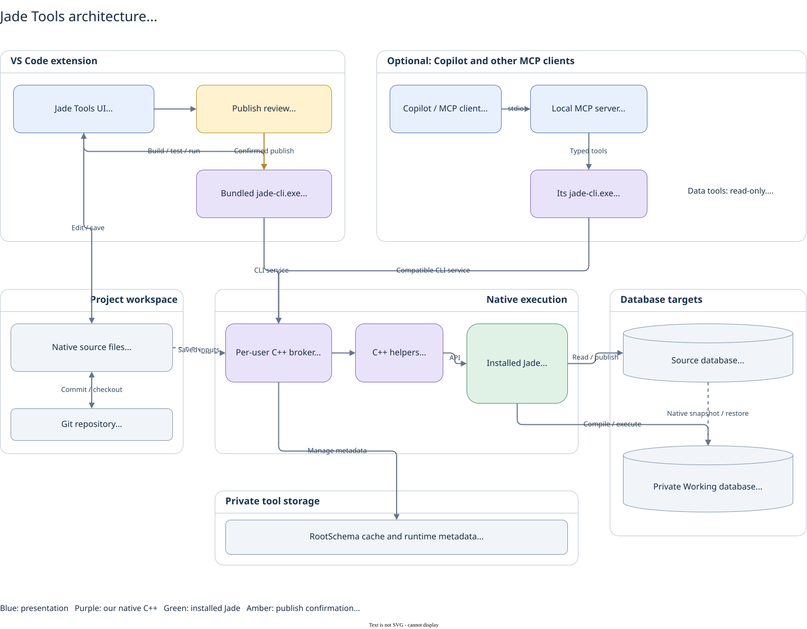
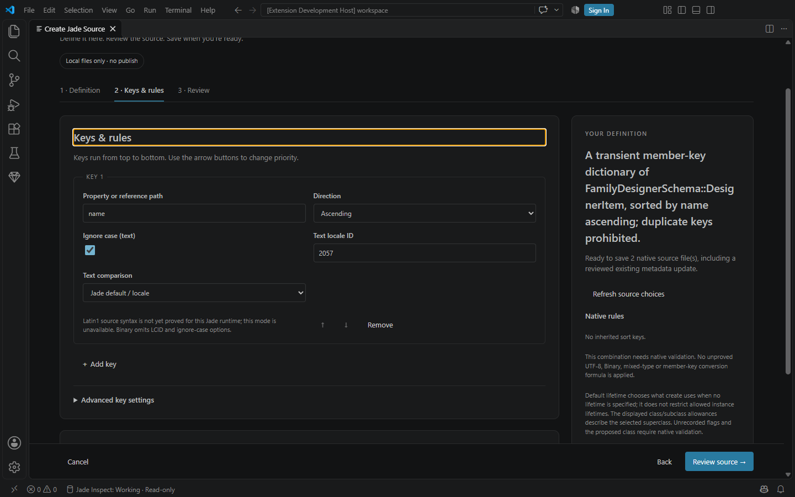

# Jade Tools for VS Code

Edit native Jade source, compile and run tests, debug supported code, and inspect database objects from Visual Studio Code. The Jade IDE is not required. A compatible Windows Jade installation is required for native compilation and execution.

The extension includes a verified native C++ CLI and our native helpers. VS Code supplies the JavaScript extension host. Users do not need a separate Node.js, Python or CLI installation. Jade vendor DLLs and databases are not distributed with the extension.

## Install and start

1. Download the VSIX from the [latest GitHub release](https://github.com/darrenhull/Jade-VSCode-Extension/releases/latest).
2. Run **Extensions: Install from VSIX...** and select it. Reload VS Code after an update; installing the same extension ID replaces the installed version.
3. Create a new folder for your source, or use **File: Open Folder** to open an existing source checkout. The folder can be empty before your first source pull.
4. Run **Jade: Detect Runtime Settings**. Choose a detected installation or **Browse to another installation folder…**. Select the Jade installation root containing `bin/jom.dll`, for example `C:\Jade2025`; this is separate from your source folder. Then select the Source database, INI and server mode when prompted. Settings belong to the selected workspace folder; Connect identifies folders by name and path in a multi-folder workspace.
5. Pull missing source with **Jade: Extract All Sources**, or work with your existing native files.
6. Use **F5** to build, **Testing** to run tests, and the separate publish controls when you intend to update Source.

GitHub releases require manual VSIX installation. A new CLI release opens a reviewed dependency update; it does not silently update an installed extension. Error Lens is an optional install-alongside companion for inline diagnostics.

## Available features

| Area | Current behaviour |
| --- | --- |
| Editor | Syntax highlighting, completion, hover, signatures, definitions, references and call navigation from source models. |
| Build | F5 saves native source inputs and builds new/changed files in the active project in Working. **Jade: Compile Current File** remains available for a focused check. |
| Test | Native unit-test discovery, Run Local Test, Testing results, individual assertion messages and source locations. Each requested test executes again. |
| Debug | Experimental gutter breakpoints, stepping, native caller stacks, selected-frame locals, object expansion and paged collections on compatible runtimes. |
| Format | Document/selection indentation for native declarations and complete method bodies, preserving tokens, literals and line endings. |
| Scratch Pad | Run native Workspace statements in Working, see output and compare the two most recent runs. F5 is for builds; Scratch Pad has its own Run action. |
| Class workspaces | Schema-qualified search, grouped current-file members and editing backed by the original document, with native undo/save. Multi-class files offer a reviewed split into individual class files. |
| Data browsing | Read-only Source/Working inspection, native object IDs, lazy reference traversal, history, pinned views and collection paging. |
| Source designer | Create schemas, classes, member/external dictionaries, ordered object arrays and unique object sets. Review source before saving. |
| Collection rules | Known inherited keys and lifetime permissions, supported key-size checks, Binary comparison, population/block sizing and reviewed existing-file class mappings. Unknown metadata stays explicit. |
| Publication | Review the destination and changed files, then explicitly confirm publication to Source. |

Opening a multi-class source offers **Review split** or **Keep combined**. The reviewed split keeps the selected class in the original file and creates sibling class files as one native, undoable edit; save all changes before compiling. It accepts saved UTF-8 complete-class extracts with supported class mappings. Partial declarations, other schema-level sections, unsupported encodings and destination conflicts are refused without overwriting files.

See the [user guide](extension/README.md), [collection coverage and limits](docs/COLLECTION-COVERAGE.md) and [changelog](extension/CHANGELOG.md).

### Everyday shortcuts

| Shortcut | Action |
| --- | --- |
| F5 | Save native source inputs and build changed project files in Working. |
| Ctrl+F5 | Run the current class's native tests in Working. |
| Shift+F5 | Review and confirm publication to Source. |
| Shift+Alt+F | Format Document on Windows. |

Build and test shortcuts apply in their supported source-editor context. Use the Command Palette or Testing view for explicit operations when another editor has focus.

## Architecture

[Editable Draw.io source](architecture/jade-tools.drawio) · [SVG](architecture/jade-tools.drawio.svg) · [Architecture details and export instructions](architecture/README.md)

The extension owns commands, source views, Testing and debugger presentation. Its bundled **jade-cli.exe** owns native orchestration: configuration, dependency selection, shared broker jobs, cancellation and warm sessions. Our C++ helpers call the installed Jade runtime; Jade provides the compiler, Object Manager and execution semantics.

Native source files in the workspace are the application source of truth and can be committed to Git. Build/test inputs are saved files; editor previews can follow unsaved buffers, and Scratch Pad explicitly passes its current code snapshot. System metadata, broker state and Working databases live in private tool storage outside the source workspace.

A separate **Working** database is prepared through a consistent native snapshot/restore of the configured **Source** database. Build, test, debug and scratch execution use Working. Source is used for explicit extraction, snapshot preparation, read-only inspection and reviewed publication. Running application code can modify Working data and use operating-system permissions; Working is not an operating-system sandbox.

### Optional Copilot / MCP integration

[Jade Local MCP](https://github.com/darrenhull/Jade-Local-MCP) is installed separately. Its official MCP SDK adapter has a packaged runtime and its own verified C++ CLI. Compatible CLI builds share the same per-user broker; the extension does not route its operations through MCP.

For Copilot-global configuration, register the server in **~/.copilot/mcp-config.json**. Keep the complete MCP release together at a stable installation path such as **%LOCALAPPDATA%/JadeTools/mcp**. Configuration and program files have separate locations. With no explicit workspace argument, the server uses the client-provided working directory.

MCP data tools are read-only for both Source and Working. Build/test tools execute in Working. Publication, arbitrary native execution and data editing are not exposed by the MCP server.

## Source designer and native limits

Choose **Jade: Create Schema, Class or Collection** from Tools or the Command Palette. Schema and member choices include project/schema identity and extracted package aliases. Imported members expose their exported interface; imported classes are not superclass choices.

The designer shows inherited keys, known property attributes and class/subclass lifetime permissions. Default lifetime and allowed lifetimes are separate. Supported aggregate String key limits and sizing bounds are checked; native compilation remains authoritative. Binary comparison is available for supported keys. Latin1, unproved placement modes, dynamic dictionaries and ad hoc indexes remain unavailable.

Selecting an existing database file reviews the new class and its authoritative schema SEC mapping together. Dirty buffers, changed disk source and stale review receipts block unreviewed writes. Saving preserves reviewed line endings and existing metadata encoding. It creates source only; compilation and publication are separate. No existing-data migration or new database file is implied.

## Runtime troubleshooting

**Jade Native: Character Set** defaults to `auto`. With no explicit VS Code override, the CLI preserves any character-set preference in the native project/connection configuration, then detects the installed runtime when no preference is set. You can explicitly choose `auto`, `ansi` or `unicode` for a workspace folder; an explicit choice is passed unchanged to the native CLI, which rejects a mismatch before opening the runtime. No default setting is written into source projects.

ANSI runtime support requires a compatible bundled native CLI. ANSI debugging and the retired legacy offline compiler/cache ABI remain unsupported until a matching native profile is verified; selecting ANSI does not make those operations available.

The extension opens native connections when needed and coordinates Object Explorer, compilation, tests and Scratch Pad through the existing CLI broker. Compatible inspection, compilation and test operations reuse the Working node. Inspection runs in a native read-only context; Source uses its own read-only connection. Opening Object Explorer first prepares a missing private Working database automatically.

Connect shows native backup, restore and connection progress in a notification and the database view. Repeated Connect commands join the same attempt. Cancel requests cancellation of that attempt and keeps it visible until the current native step finishes safely; a Source backup may need to finish before cancellation takes effect. A failed attempt retains its native error and permits a deliberate retry.

Initial Working preparation and structural loads can take longer than warm builds. Native structural loads reconnect automatically and invalidate old inspection cursors and snapshots. Refresh to retrieve current objects. Warm sessions reuse verified loaded source; every test still executes. Scratch Pad uses the supported non-GUI Jade client so write output is delivered reliably; this requires an automatic connection handoff rather than retaining the same physical node. Debugging and exclusive native utilities also hand off the connection safely; subsequent operations reopen it lazily. A paused debugger is never silently disconnected.

If an older CLI build owns the broker, finish its active operations and use the CLI's **status** and **shutdown** commands for a graceful handoff. Reload all VS Code windows and reconnect other clients so they use their updated packages. Do not terminate unrelated native processes or delete broker/database files to bypass the version check.

For connection conflicts, use **Jade: Disconnect Build and Test Runtime** or **Jade: Disconnect Database Objects** as appropriate. A single-user Source database must be available during initial native backup. Supported multi-user connections use the native online-backup path; the extension does not silently change the Source server mode or INI.

## Class and object workspaces

Open a class from search, the catalogue or Object Explorer to browse its current-file declarations and edit local methods in context. The method canvas and original source share the real document, completion, diagnostics and native undo/save. Save writes the entire backing file; build and publication remain separate actions. Opening another file is explicit, and rejected edits have protected recovery controls.

Instance browsing offers an explicit database target. Object and collection pages remain read-only snapshots with retained history, paging and stale-state handling. See the [user guide](extension/README.md#browse-and-create) and [implementation plan](plans/class-object-workspace.md).

## Development

Build this repository independently with the pinned Node version used by CI (currently 24.22.1) and npm:

~~~text
npm ci --ignore-scripts --no-audit --no-fund
npm test
npm run package
~~~

The standalone [Jade CLI repository](https://github.com/darrenhull/Jade-CLI) owns native development. The committed package under **packages/jade-cli-win-x64/** and its pin supply the backend; sibling checkouts are not build dependencies. Packaging verifies the official manifest receipt and native runtime hashes. VSIX output is written to **dist/** and is not committed.

Default tests do not opt in to a developer database. Connected/native and actual VS Code host checks require explicit configuration and disposable fixtures. The host harness owns its private profile, workspace and broker context, checks free space before copying, and removes its own artifacts after its processes exit. It reports retained paths if cleanup cannot complete. Regenerable caches belong outside source under private tool storage, with bounded retention.

### Review and releases

Pull requests target **main** and require owner approval and passing checks. CI validates a PR and its reviewed merge to main; feature pushes run only lightweight PR automation. Successful reviewed main builds publish a new version to GitHub Releases. Existing versions and release artifacts are immutable; documentation-only merges do not overwrite an existing release.

CLI release polling opens Draft dependency-update PRs with verified packages and a consumer version update. Implementation, integrity, CI and review findings must be complete before requesting owner review. GitHub's five-minute scheduling is best-effort, not a five-minute delivery guarantee; delayed or dropped runs can postpone detection. The workflow's Actions history distinguishes automatic schedule runs from explicit workflow_dispatch recovery runs. Extension, CLI and MCP are independently versioned products.

Jade Tools is independent third-party tooling and is not affiliated with or endorsed by Jade Software Corporation Limited. Jade is a trademark of Jade Software Corporation Limited.

### Large-schema extraction

Extract All Sources uses `jadeNative.extractionTimeoutSeconds` (default 3600 seconds, configurable from 1 to 86400 per workspace). Increase it for very large schemas. This is separate from the test timeout and prevents the generic two-minute native utility limit from interrupting extraction. Cancel requests termination of the owned extraction; the operation waits for native completion before cleaning up. Streaming extraction retains already-applied files after timeout or cancellation; its output reports the acknowledged prefix and any uncertainty. Timeout failures identify the setting in the error message.

### Pull one selected class from Source

**Jade: Pull Selected Class from Source (Streaming)** is available from a saved, single-class/interface CLS editor or an Object Explorer class context menu when the bundled CLI advertises the streaming capability. It pulls the **current** Source version directly to that class file, with native comparison and one file candidate at a time. It does not run a full schema export. Selected Forms include their same-stem DDX definition with a separate editor permission check. Multi-class files and unsaved editor/class-view changes are refused.

An unchanged file keeps its timestamp. Local edits and conflicts are retained; a verified saved remote receipt can supply the prior baseline. No baseline is invented from the current local bytes. The output distinguishes files written, unchanged, kept locally and conflicted, with native stage timings. Cancellation or failure may leave already-applied files in place; a lost native completion is reported as uncertain and the selected source scope is refreshed.

This selected-class route does not extract complete schema resources or detect deletions, and does not replace **Extract All Sources**. It requires the native streaming CLI capability; an older bundle reports the missing capability instead of silently running a batch export.

### Extract complete Source into a new project

Open your source folder, configure its Source runtime settings, then run **Jade: Extract All Sources**. You do not need a current CLS or class selection. The full streaming capability must be present in the bundled native CLI; a selected-only bundle reports the missing capability before creating source files.

Jade/CLI discover and serialize the current user schemas directly into the configured extraction folder, including native schema headers, sections, class/interface sources and one complete `schemaResources.ddx` per schema. Each file is checked and promoted individually. Preparation, native inventory and acknowledged file progress are visible from the first click; repeated clicks while preparation is waiting do not start another pull. Index/test/class refreshes are grouped at the end.

Saved local edits, conflicts, dirty source editors and unsubmitted class-view drafts remain protected. An unchanged file keeps its timestamp. Cancellation or failure can leave already-applied files in place, and unconfirmed native outcomes are reported as uncertain. A complete native inventory does not authorize deletion: workspace files missing from the export are retained. Jade's complete native serializer writes private candidate source, then the CLI compares/applies guarded files one at a time. The extension does not rebuild export categories or create another organized source copy.

Full streaming extraction requires the qualified `schema-ddx` resource layout. Individual Form DDX files from an older layout require a reviewed migration before full refresh; files are not automatically removed or replaced. For an existing aggregate schema, a selected Form pull offers **Refresh Schema Source**. For a complete extracted project, run **Jade: Publish Workspace Schemas and Resources**. The command validates a frozen native joined bundle in Working, captures the target for review, then loads those same joined bytes after approval. Source files added, deleted or changed during approval, and dirty/pending source editors, stop publication. Empty inherited reference files remain on disk without being advertised as local class additions/deletions. Whole-schema aggregate resources are not automatically attached to a single-class publish.

Review is a point-in-time target snapshot, not an atomic lease against external database writers. Complete-schema loading is authoritative within the listed schemas, and earlier successful schema loads may remain if a later load fails.
