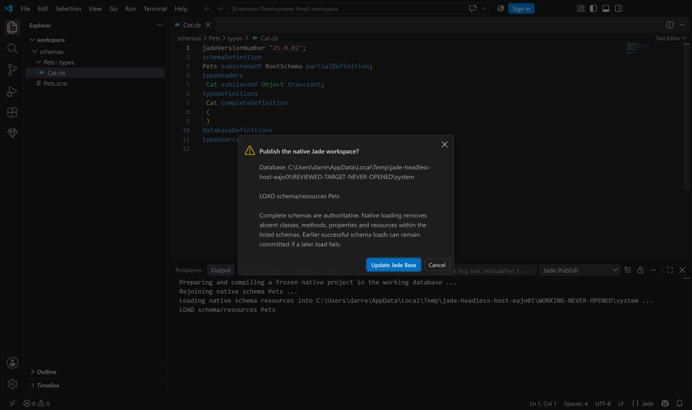
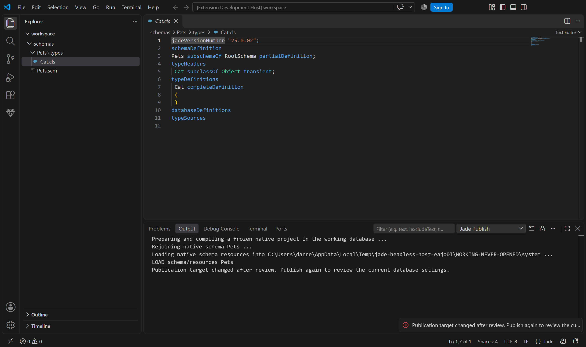

# Publication target review identity

Child [#114](https://github.com/darrenhull/Jade-VSCode-Extension/issues/114) addresses one acceptance gap in [#35](https://github.com/darrenhull/Jade-VSCode-Extension/issues/35). The broader structural-impact feature remains open.

After the publication modal, the registered native-workspace handler re-reads the existing database-path, INI-path and server-mode identity. A change invalidates confirmation before target renames or schema loading. The user must run publication again to review the current settings. Existing saved-source, membership and draft checks remain in place. This does not provide an atomic lock against other writers or detect replacement of a target at unchanged paths.

Three actual-handler controls failed before the fix and all14 focused publication controls passed afterward. An actual packaged VS Code host displayed the reviewed target, accepted confirmation after a controlled configuration change, then displayed the actionable refusal. Its native extraction/loader boundary was controlled: no native executable or database was opened. The package contains119 exact JavaScript modules and the unchanged verified official0.10.10 runtime. See [the receipt](../test-evidence/issue114-target-review.json) for identities and limits.

