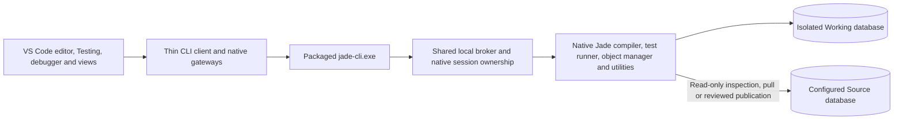

# Jade Native Runner 0.11.0

Edit Jade source in VS Code, compile and run native tests through the packaged Jade CLI, and publish after reviewing the target changes. A compatible Windows Jade runtime is required. The Jade development IDE is not required.

## Architecture



The CLI is a pinned package included in this VSIX. The extension launches the bundled standalone `jade-cli.exe` directly, with its runtime files. End users do not need a sibling checkout, a globally installed CLI, Python or a separate Node.js installation. Node.js and npm are development build tools only. The broker retains warm native build/test state. The CLI and extension are independent Git repositories; SDK/native development belongs to the CLI product.

## Start

1. Open a folder containing native Jade source, or use **Jade: Extract All Sources** to pull source from a configured database.
2. Set **jadeNative.installPath** to the compatible Jade installation. Configure **databasePath**, **iniPath** and **server** if their defaults are unsuitable, or use **Jade: Detect Runtime Settings**.
3. Open a class file and press **F5** to compile it in the private Working database.
4. Use **Testing**, **Run Local Test**, or **Ctrl+F5** to run native Jade tests.
5. Use **Publish All Changed Files** or **Shift+F5** to review and confirm publication to Source.

Source and Working are distinct databases. Compilation/test execution uses Working; publication updates the configured Source target. Test/application code can modify Working data. Database Objects inspection is read-only.

## Source files and schemas

Native CLS, SCM, SEC, DDX and JCF files remain the source of truth. Extraction writes user schema source into the selected folder inside the workspace, without timestamped output directories. Schema headers are siblings of their schema folders; classes/resources are grouped by native role. System metadata and tool state remain outside the user source tree.

Use **Jade: Create Schema** to scaffold a native schema and runtime classes. Publish the resulting schema/resources through the reviewed workspace workflow. Explicit class rename migrations preserve native data; complete native schema loads can remove absent declarations, so review the publication plan.

Pulling protects local changes and uses pull/publish baselines. Full extraction and initial schema/resource joins can be slow; they expose progress and cancellation. RootSchema cache refresh provides editor metadata; it is not a replacement for the executable Working database.

## Editor and source browsing

Syntax highlighting, completion, hover, signatures, definitions, references, implementations and incoming/outgoing calls use the source models. Dynamic dispatch is not predicted. Schema-qualified identities distinguish classes with the same short name in different schemas.

**Object Explorer** groups schemas, classes, properties and methods. Its search icon opens a catalogue with schema filters, autocomplete and bounded pages. Selecting members reuses one focused preview tab per schema/class; unsaved edits appear in previews. **Open Original Source** opens the editable native file.

Build/test/publish deliberately save their source inputs. The command-line client reads disk; it does not automatically see unsaved editor buffers.

## Tests and diagnostics

Native compiler errors appear in **Problems** and **Jade Compile** output. Errors retain their Jade codes and mapped method/file/line/column. Structural errors show generated locations when an original mapping is unavailable.

Test Explorer discovers native unit-test methods, runs the native lifecycle and reports individual failures, assertion messages and source locations. Test results are never cached as executions. Only verified loaded-source state is reused, including when switching between test classes. Initial builds remain slower than warm runs.

## Database Objects

Choose **Source** or **Working** explicitly, then connect. Browse schemas/classes, search for a class, page persistent instances, inspect an OID and follow stored references. Collections retain native order and dictionary keys. Pin/history/copy actions and current-page filtering/sorting are available.

Inspection does not invoke mapped getters or edit stored values. Native application security remains enforced. Identical OIDs in Source and Working identify different objects. Compile, publish and debugging coordinate native ownership; a session held by another client can produce a clear busy response. Disconnect it before starting a conflicting operation.

Class catalogue UI pages are bounded to 100 rows, but the native metadata catalogue is still acquired eagerly. The inspector transport limit is currently 8 MiB. This is not native metadata streaming.

## Keyed collection designer

Run **Jade: Create Keyed Collection** from the Command Palette. Choose a schema, collection name, collection class and member/external key mode. Select ordered composite keys, ascending/descending order, duplicate-key policy and optional text case/locale settings. Inherited properties and reference paths are available. Advanced controls include compatible dictionary superclass and load factor.

The designer previews/copies native source and creates a CLS file. Press F5 to compile; publication is a separate reviewed action. It currently handles keyed dictionaries, not general arrays, sets, runtime dynamic collections or ad hoc query indexes. Complete inverse/relationship and lifetime/key compatibility checks are not all performed in the form; native validation and runtime rules still apply.

## Debugger

The experimental native debugger supports gutter breakpoints, parameterless method launch, selected test debugging, stepping/pause, native caller stacks, selected-frame locals/parameters, object expansion and paged collections. The Testing Debug profile retains native test setup/teardown. Stored non-GUI applications can use their native startup/finalisation lifecycle.

Its private native ABI is pinned to the verified Jade DLL build. Unsupported builds fail explicitly. Arbitrary watch evaluation, exception-break settings, unrestricted process attach, variable editing and GUI application hosting are not implemented. Simple variable reads are supported. Persistent debug writes are restricted to Working; Source is rejected.

## Runtime and settings

The installed Jade runtime remains external. The CLI packages our helpers and native compatibility metadata, not Jade DLLs or databases. SingleUser Source must be free for initial backup; MultiUser Source supports the native quiesced online-backup path. Source clients stay connected while updates briefly pause. The extension does not silently switch server mode or rewrite the original Source INI.

Useful commands include **Jade: Refresh Type Cache**, **Jade: Show Working Database**, **Jade: Recreate Working Database**, **Jade: Disconnect Build and Test Runtime**, and **Jade: Disconnect Database Objects**.

The native state/cache location is configurable through the extension settings. Broker state is private per user. The CLI honours `JADE_TOOLS_STATE_DIRECTORY` for isolated test brokers. Do not use production Source databases as test fixtures.

## Build this extension

Open this repository's root workspace and run:

```text
npm ci
npm test
npm run package
```

Packaging reconstructs the CLI bundle from the pinned package artifact. Node modules, generated bundles, VSIX output, reports, databases and local research notes are ignored by Git. Use the separate CLI repository to develop or rebuild native helpers; changing an old local helper copy does not change the CLI artifact used by this extension.

The default tests do not open Jade databases. Actual-host/native controls require explicit private fixture configuration. See the repository build scripts and test files for opt-in controls. Publishing this extension means packaging/installing its VSIX; it does not deploy source code into a Jade database.

## Architecture diagram


[Editable draw.io source](media/architecture.drawio).
