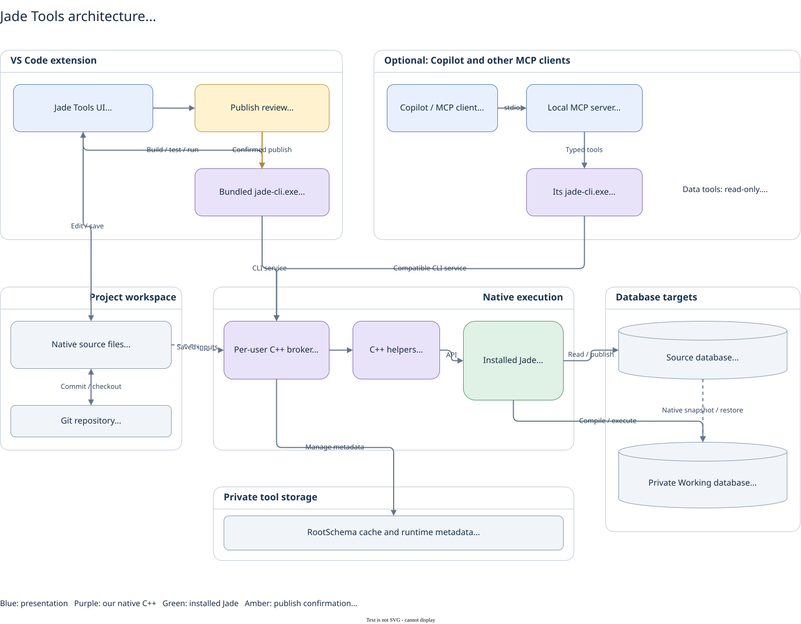

# Jade Tools

Edit, build, test and explore Jade applications in Visual Studio Code. Work with native Jade source files, see compiler errors in your editor, run unit tests and review changes before publishing them to your database.

A compatible **Windows Jade runtime** is required. The **Jade IDE is not required**. The extension includes its command-line tools; you do not need to install Node.js, Python or a separate CLI.

**Jade Native: Character Set** normally stays on `auto`. The native CLI respects a project/connection preference when VS Code has no explicit override, then detects the installed runtime. Optional workspace overrides are `auto`, `ansi` and `unicode`; explicit mismatches fail before runtime sign-on. ANSI debugging and the retired legacy compiler/cache ABI remain unsupported unless a matching native profile is verified.

## Get started

1. Install the `.vsix` from the [latest GitHub release](https://github.com/darrenhull/Jade-VSCode-Extension/releases/latest) using **Extensions: Install from VSIX…**. Reload VS Code when prompted.
2. Create a new folder for your Jade source, or use **File: Open Folder** to open an existing source folder. It can be empty before your first pull.
3. Run **Jade: Detect Runtime Settings**. Choose a detected installation or **Browse to another installation folder…** and select the installation root containing `bin/jom.dll`, for example `C:\Jade2025`. This is separate from your source folder. Then select the Source database, INI and server mode when prompted. Settings belong to that workspace folder; Connect identifies folders by name and path in a multi-folder workspace.
4. Use **Jade: Extract All Sources** to pull source inside your workspace, or work with your existing native files.
5. Open a class file and press **F5** to compile. Use **Testing** or **Run Local Test** above a test to run it.

GitHub VSIX updates are installed manually. Installing a newer VSIX updates the same extension; there is no need to uninstall it first.

## Develop in the editor

| Feature | What you can do |
|---|---|
| Jade language support | Use highlighting, completion, hover, signatures, definitions and references in native source files. |
| Compile | Press **F5** to save and build new and changed sources in the active project, including required dependencies. Use **Jade: Compile Current File** for a focused check. Compiler errors appear in **Problems** and **Jade Compile** output. |
| Scratch Pad | Open **Jade: New Scratch Pad** to try Jade code in Working without publishing a class. Choose a schema, press **Run**, and compare the last two runs. |
| Format | Run **Format Document** or **Format Selection** to indent CLS headers, declarations, collections, database mappings and complete method bodies. Editor tabs/spaces are respected; literal text and Jade tokens are preserved. |
| Test | Discover and run unit tests in **Testing**, use **Run Local Test**, and inspect individual failures and assertion messages. |
| Debug | Set gutter breakpoints, step through supported methods/tests, inspect call stacks and expand objects and collections. |

**Format Document:** `Shift+Alt+F` on Windows. **Format Selection:** `Ctrl+K`, then `Ctrl+F`. Formatting changes indentation; it does not fix syntax errors. Incomplete or unknown structures and encrypted source contents are preserved.

For a wrapped statement or declaration, include its first line in the selection so the following lines can be indented together.

**Error Lens** is installed alongside Jade Tools when Marketplace access is available. It displays compiler diagnostics beside their source lines and can be disabled or uninstalled independently. Offline users can install its VSIX separately.

## Scratch Pad

Choose **New Scratch Pad** under Tools, select a schema, type Jade code and press **Run**. Save the page to keep its code and optional notes in source control; run output is not saved with it. After two runs, use **Compare Previous Scratch Pad Run** to compare the code and results.

Markdown cells have **Edit Markdown** and **Preview** actions. To show a diagram, put it in a fenced `mermaid` block, or use **Insert Mermaid Diagram** to wrap raw diagram text. Rendering uses the installed Markdown renderer; current VS Code has built-in Mermaid support. The native **Run Cells In Section** action is different: it executes code cells below a heading.

Choose **Edit with Copilot** on an existing code or Markdown cell to edit it in place. Markdown opens in its native source editor so notes and Mermaid text can be updated without creating another cell or running Jade. It receives Mermaid guidance rather than Jade code rules. Markdown uses VS Code's native notebook editing agent because the older inline editor can truncate fenced content. On first use, choose **Enable and Reload** to enable that experimental native feature for this workspace; global settings are unchanged. If your VS Code does not provide it, update VS Code and Copilot. Code Edit/Fix remain available independently. After a native cell failure, **Fix with Copilot** opens a short native request with diagnostic chips. Read-only attachments supply the entire cell, its exact error details, selected schema and Jade syntax guidance without inserting that context into the source or visible request. Both Edit and Fix give native editing the entire existing cell as their scope, including when the cursor was at the end or only a few words were selected, so Copilot can update any affected line without inserting a whole body into a partial selection. The fix prompt prefers the smallest necessary edits to any affected lines. If a complete body is needed, it must replace the whole cell in place, without inserted or appended duplicates. It does not send the request or execute code automatically. Changing the cell or schema invalidates the old failure context; rerun to capture a current error. Errors in another CLS file must be fixed in that source file. Copilot proposals still need review, acceptance and a native rerun.

Each run has separate local variables. Changes your code commits to Working data can remain for later runs. Interactive input is unavailable, and F5 does not execute scratch code.

Before execution, Jade prepares the saved workspace definitions. A compiler error in those files can prevent the scratch code from running; the result includes the native diagnostic and reported source location. Idle Database Objects inspection is released automatically before a run. An active build or test retains ownership until it finishes or is cancelled.

## Project skills

In trusted local Jade projects, Jade Tools installs three bundled agent skills under `.github/skills/`: **jade-language**, **mermaid** and **drawio**. Detection uses `jade.json`, known native source or opened class headers. Jade language guidance covers all 18 primitives in the official inventory, descriptor and conversion rules, a language syntax topic index, native numeric `.String` conversion, advanced string construction, typed date/time formatting, CLS extract structure and official references. Tested native examples are distinguished from illustrative syntax fragments. The diagram skills cover fenced Markdown previews and editable diagrams with exports. These are project files you can keep in source control.

The extension preserves customised skills and unsaved skill edits. It updates only unchanged files it manages, and does not install into untrusted workspaces. Copilot's agent can select the skill for Jade authoring; inline Tab suggestions use a different context path and are not guaranteed by the skill.

## Browse and create

Choose a workspace class from **Find Class**, the class catalogue or **Object Explorer** to open its **Class Workspace**. Its grouped member rail searches declarations in the current file and shows up to 100 at a time. Use the kind filter and resolved inherited-member toggle to narrow the list; **Back to Classes** restores the originating search, tree or catalogue context.

Selecting a local method, property or reference opens an editable canvas backed by its original source document, with completion, diagnostics, navigation and native undo. Use **Save file** or **Ctrl+S**; saving writes the entire current file, including other unsaved member edits. Configured Auto Save also applies. **Open Original Source** shows that same buffer. Build and Publish remain separate actions. A second class sharing the same physical file opens in a separate editor group so its page can keep its own selection while sharing the document.

Each page keeps its current backing file. It does not switch or close that file to edit a method from another partial file. Opening another source file or declaring class is explicit; separately opened files retain their own pages and native undo history.

If a source update rejects an edit, a recovery card preserves the method draft across reopening. Review or copy it, explicitly restore it into the real document, or confirm its discard before editing resumes. Recovery checkpoints stay in VS Code's private workspace storage. Large methods and exhausted recovery capacity explain why protected inline editing is unavailable and offer **Open Original Source**.

Inherited methods in another file have an explicit **Open declaring class** action. Missing or ambiguous source stays unavailable with an explanation. **Instances** asks which database target to browse; it does not publish an unpublished class. Object and collection pages remain read-only snapshots, retain history and page state, and show their last values as stale after disconnection.

Use the filter icon beside a database class to open its instance results with the same autocomplete and grid controls as class search. Instance filtering searches identities, class names and schemas on the **current native page**. It does not scan the database or evaluate property values. Clear restores that page; Next and Return to first page retain native cursor paging.

- **Jade: Create Schema, Class or Collection:** open the shared designer from Jade Tools or the Command Palette. Choose a project and schema, define a class, keyed dictionary, ordered object array or unique object set, and review the summary and native source before saving. Search schema-qualified superclasses, member classes and key properties. Use Back to adjust choices without losing the draft. A new schema's header stays beside its folder in the configured source subfolder.
- Review inherited keys and known property attributes, duplicate policy and lifetime permissions. Unknown metadata remains clearly identified; a default lifetime does not restrict other lifetimes. Sizing offers either expected population or entries per block with verified source bounds. Actual runtime allocation remains native-dependent. Binary comparison is supported; Latin1 and unproved placement/partition modes remain unavailable with reasons.
- Select an existing database file to review a new class and its class-map change together. Saving uses VS Code's standard edit/undo path for the existing schema SEC file and protects dirty buffers or source changed since review. It does not create database files, migrate existing data, compile, publish or create stored instances. Class maps and exclusive-instance owner placement are distinct.
- Type choices use workspace source, schema ancestry, extracted package exports and the verified RootSchema cache. Imported members retain their alias and exporter context, including inherited aliases. Key choices expose exported properties; imported classes cannot be superclasses. Missing cache/export metadata is explained. Native compilation remains authoritative.
- **Object Explorer:** search schemas and classes, navigate properties and methods, and open a focused member preview. **Open Original Source** opens the editable native file.
- **Database Objects:** choose **Source** or **Working**, search for a class, browse persistent instances, follow stored references and page through collections. This browser is read-only.

Connecting shows native backup/restore and connection progress. Repeated Connect commands share the current attempt. **Cancel** waits for the current native step to finish safely; an in-progress Source backup may need to complete first. Failures show the native cause so you can address it before retrying.
- **Jade: Create Keyed Collection:** retain the existing dictionary workflow for ordered composite keys and native CLS preview. Use the shared designer for arrays, sets and the expanded native rules. Dynamic indexes remain unavailable.
- **Jade: Create Schema:** create the native schema files and runtime classes in your workspace.

## Compile safely, publish deliberately

Builds, tests and debugging use a separate **Working** database. They do not publish your local source to **Source**. Executed Jade code can change Working data and access files or networks permitted by your runtime; Working is not an operating-system sandbox.

Use **Publish All Changed Files** or **Shift+F5** when you want to update Source. Review the destination and file changes before confirming publication. Build, test and publish commands save their source inputs.

The first build can take longer while Working is prepared. Later runs reuse verified loaded source; tests still execute on every run. Disconnect an inspection session if it holds a conflicting single-user connection.

## How it connects

The extension presents commands, source views, Testing and debugging in VS Code. Its bundled **native C++ CLI** manages configuration, dependencies, jobs and warm sessions. Our C++ helpers call the installed Jade compiler, Object Manager and utilities. Jade supplies the native compilation and execution semantics; vendor DLLs and databases are not packaged with the extension.

Workspace files remain your application source and can be committed to Git. System metadata, broker state and Working databases stay outside the source checkout. The type cache supplies editor metadata; native builds and tests still use the real Working database.

The optional [Jade Local MCP server](https://github.com/darrenhull/Jade-Local-MCP) has its own packaged runtime and compatible CLI, sharing native broker ownership with the extension. Copilot-global registration uses **~/.copilot/mcp-config.json**; the executable can remain in a stable installation folder such as **%LOCALAPPDATA%/JadeTools/mcp**. MCP inspection is read-only; its build/test tools use Working and it exposes no publication tool.

[Editable Draw.io diagram](https://github.com/darrenhull/Jade-VSCode-Extension/blob/main/architecture/jade-tools.drawio) · [SVG and architecture details](https://github.com/darrenhull/Jade-VSCode-Extension/tree/main/architecture)

After updating, reload all VS Code windows and reconnect other clients. If an older native CLI still owns the broker, finish its active work and use its **status** and **shutdown** commands before starting the new build. Use graceful CLI shutdown rather than terminating unrelated processes or deleting database files.

## Source-pull progress

**Extract All Sources** shows native extraction, file discovery and hashing, source organization, comparison, application and editor refresh as separate stages. **Jade Extract** output records elapsed stage durations. The native-stage class count only observes files written so far; it is not a completion percentage. Hashing uses the actual discovered file total. Native observation scans stop once the extractor exits.

This progress reporting does not make a pull incremental: the current batch route still exports all source. Local-conflict review and unsaved-editor protection remain in effect.

## Pull a selected class

Use **Jade: Pull Selected Class from Source (Streaming)** from a saved single-class/interface CLS editor or an Object Explorer class context menu. It pulls the current Source version with native comparison, without a full schema export. Selected Forms include their same-stem DDX definition with a separate editor permission check. Unsaved edits are protected; conflicts are retained with guidance and unchanged files keep their timestamps.

The output shows native stages and file outcomes. Cancellation/failure can leave an already-applied prefix; an unconfirmed native completion is reported as uncertain. This class-only action does not extract complete schema resources, detect deletions or replace **Extract All Sources**.

## Useful commands

Open the Command Palette with `Ctrl+Shift+P` and type **Jade** to find the available commands, including:

- **Jade: Detect Runtime Settings**
- **Jade: Extract All Sources**
- **Jade: Pull Selected Class from Source (Streaming)**
- **Jade: Create Keyed Collection**
- **Jade: Create Schema, Class or Collection**
- **Jade: Create Schema**
- **Jade: Refresh Type Cache**
- **Jade: Show Working Database**
- **Jade: Disconnect Build and Test Runtime**
- **Jade: Disconnect Database Objects**

Debugger support requires a compatible runtime. GUI application hosting, arbitrary watch expressions and editing stored values in the data browser are not available. Native Jade validation remains authoritative for collection definitions and source changes.

[Source, architecture and development documentation](https://github.com/darrenhull/Jade-VSCode-Extension) · [Report an issue](https://github.com/darrenhull/Jade-VSCode-Extension/issues)

Jade Tools is an independent third-party extension and is not affiliated with or endorsed by Jade Software Corporation Limited. Jade is a trademark of Jade Software Corporation Limited.
