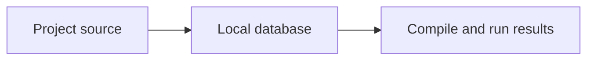

# Mermaid diagrams

Choose the diagram type to match the requested relationships. Preserve the user's concepts and source; do not turn an explanation into a deployment or database change.

## Authoring and preview

- In Markdown files or Scratch Pad Markdown cells, put diagram source inside a fenced code block labelled `mermaid`. Plain `flowchart TD` text is not a rendered diagram. A standalone `.mmd` file contains only the raw source.
- Use the Markdown cell's Preview/Edit Markdown control. A diagram in a note is not Jade code and must not be sent to the Jade runner. Convert a raw diagram to a fenced Markdown block before previewing it.
- Check the renderer's Mermaid version before choosing newer or experimental syntax. Current VS Code includes a Mermaid notebook/Markdown renderer; older versions or disabled renderers may need separate setup. A skill does not install or enable a renderer.
- Use stable simple node IDs and quoted human-readable labels. Keep labels concise, choose one primary direction, group meaningful boundaries and label important connectors.
- Preserve original source when fixing a syntax error. Check fences, diagram type, quotes, brackets and reserved words before simplifying or replacing the diagram.
- Render the actual result when a compatible renderer is available and inspect it for errors, clipped labels, crossings and legibility. Report rendering as unverified when only source was checked. Do not claim a picture was exported unless an actual export exists.

Example Markdown content:

Use the user's requested output format. Keep Mermaid source editable; export SVG/PNG only when needed. For an editable draw.io artifact, use the project's drawio skill rather than renaming Mermaid text to `.drawio`.

## Official references

- [Diagram syntax and supported types](https://mermaid.js.org/intro/syntax-reference.html)
- [Flowcharts](https://mermaid.js.org/syntax/flowchart.html)
- [Sequence diagrams](https://mermaid.js.org/syntax/sequenceDiagram.html)
- [Class diagrams](https://mermaid.js.org/syntax/classDiagram.html)
- [Entity relationships](https://mermaid.js.org/syntax/entityRelationshipDiagram.html)
- [VS Code's built-in Mermaid renderer](https://github.com/microsoft/vscode/tree/main/extensions/mermaid-markdown-features)

Do not upload private project information to an external diagram service unless the user has requested or approved that service.
